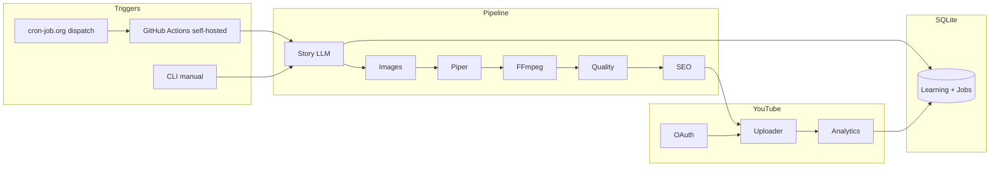

# Implementation Status — YouTube Channel Manager

**Last updated:** 2026-11-11  
**Workspace:** `/Users/rohitjaiswal/Desktop/youtube content`

## Phase 1 — Existing project inspection

| Finding | Detail |
|--------|--------|
| Repository state | **Greenfield** — directory was empty (no prior modules to reuse) |
| Git | Not initialized in workspace |
| Prior integrations | None |

## Phase completion matrix

| Phase | Description | Status | Notes |
|------|-------------|--------|-------|
| 1 | Inspection & architecture | **Done** | Documented here |
| 2 | Config, DB, secrets | **Done** | Pydantic settings, SQLAlchemy models, `.env.example`, tests |
| 3 | Cloudflare + Ollama LLM | **Done** | Router, usage logging, rate-limit fallback (needs live API keys to verify) |
| 4 | Story + scene breakdown | **Done** | JSON schema, lesson injection (needs LLM to E2E test) |
| 5 | Piper TTS | **Done** | Male/female HI/EN voice mapping (needs ONNX models on disk) |
| 6 | Images + character consistency | **Partial** | ComfyUI client + placeholder/fallback; Comfy workflow is minimal template |
| 7 | FFmpeg video + subtitles | **Done** | Slideshow, concat, burn-in SRT (needs ffmpeg locally to E2E test) |
| 8 | Thumbnail + SEO | **Done** | Variants + scoring; SEO via LLM |
| 9 | Pre-upload QC | **Done** | ffprobe-based checks |
| 10 | YouTube OAuth | **Done** | Flow, token storage, dashboard routes (**requires your Google Cloud setup**) |
| 11 | Private test upload | **Pending** | Blocked on OAuth + `client_secrets.json` + private test run |
| 12 | Scheduled publishing | **Partial** | Scheduler helper + upload `publishAt`; not fully exercised |
| 13 | Analytics API | **Partial** | Basic reports query; snapshots not scheduled yet |
| 14 | Mistake detection & learning | **Partial** | Engine + DB tables; not wired post-upload cron |
| 15 | SEO/growth automation | **Partial** | Topic research + SEO; search rank tracking table/schema TBD |
| 16 | Dashboard + notifications | **Partial** | Basic HTML dashboard; Telegram/SMTP optional |
| 17 | GitHub Actions + cron-job.org | **Partial** | Workflow file added; **self-hosted runner labels must be registered on your Mac** |
| 18 | End-to-end testing | **Pending** | Unit tests pass; full pipeline needs local tools + OAuth |

## Acceptance criteria (18-point checklist)

| # | Criterion | Status |
|---|-----------|--------|
| 1 | Original story | Implemented (LLM) — not E2E tested |
| 2 | Structured scenes | Implemented |
| 3 | Male/female narration | Implemented (Piper) |
| 4 | Scene images | Fallback yes; ComfyUI optional |
| 5 | FFmpeg complete video | Implemented |
| 6 | Synchronized subtitles | Implemented (scene-timed) |
| 7 | Thumbnail | Implemented |
| 8 | SEO metadata | Implemented |
| 9 | QC passes | Implemented |
| 10 | Google OAuth | Implemented — **user action required** |
| 11 | Channel verified | Implemented — **user action required** |
| 12 | Private test upload | **Not verified** |
| 13 | Thumbnail/metadata verified on YT | **Not verified** |
| 14 | Analytics retrieved | **Not verified** |
| 15 | Learning DB stores performance | Schema yes; automation **pending** |
| 16 | Next video uses learning | Implemented in story generator |
| 17 | Scheduled automation on Mac | Workflow only; runner **pending** |
| 18 | Logs & notifications | Logging yes; notifications optional |

## Module inventory

### Completed (code present + unit-tested where noted)

- `app/config/settings.py`
- `app/database/*`
- `app/ai/providers/*`, `story_generator.py`, `seo_generator.py`, `topic_researcher.py`, `learning_engine.py`, `performance_analyzer.py`
- `app/voice/*`
- `app/images/*` (fallback path tested indirectly)
- `app/video/*` (subtitle + thumbnail tests)
- `app/youtube/oauth.py`, `channel_manager.py`, `uploader.py`, `analytics.py`, `scheduler.py`
- `app/automation/pipeline.py`, `job_manager.py`, `notifications.py`
- `app/dashboard/app.py`
- `app/main.py` CLI
- `.github/workflows/generate_youtube_video.yml`
- `tests/*`

### Incomplete / broken (honest)

- **ComfyUI workflow** — placeholder node graph; must match your local checkpoint name (`model.safetensors`).
- **Faster-Whisper subtitle verification** — dependency listed, module not wired into QC yet.
- **APScheduler** — dependency listed; local periodic analytics/QC not implemented.
- **Search ranking tracker** — SEO experiments field exists; collector not implemented (no scraping bots).
- **Post-upload learning loop** — not automated after upload.
- **Dashboard charts/date filters** — minimal UI only.

## Required credentials (never commit)

| Credential | Purpose |
|------------|---------|
| `CLOUDFLARE_ACCOUNT_ID`, `CLOUDFLARE_API_TOKEN` | Workers AI (optional if using Ollama) |
| Ollama local | Fallback LLM |
| Piper ONNX voices in `data/voices/` | TTS |
| `client_secrets.json` | Google OAuth desktop/web client |
| YouTube API quota | Upload + analytics |
| GitHub PAT (cron-job.org → repository_dispatch) | Schedule triggers |
| Self-hosted runner registration token | MacBook runner |
| `TELEGRAM_*` or SMTP | Optional notifications |

## Tests performed

| Test | Result |
|------|--------|
| `pytest tests/` | **5 passed** (2026-11-11, local venv) |

## Next actions (manual — blocking)

1. **Google Cloud Console:** Enable YouTube Data API v3 + YouTube Analytics API; create OAuth client; download `client_secrets.json`; add redirect `http://127.0.0.1:8765/oauth2/callback`.
2. **Install tooling:** `ffmpeg`, `piper` + Hindi/English voice models, optional Ollama/ComfyUI.
3. **Copy** `.env.example` → `.env` and fill non-secret paths.
4. Run `python -m app.main init-db` then `python -m app.main serve` → open **Connect YouTube**.
5. Run `python -m app.main generate` (no `--upload`) to validate local production.
6. Run `python -m app.main generate --upload` with `PRIVACY_MODE=private` for test upload.
7. Register GitHub self-hosted runner with labels: `self-hosted`, `macOS`, `youtube-ai`.

## Architecture diagram

